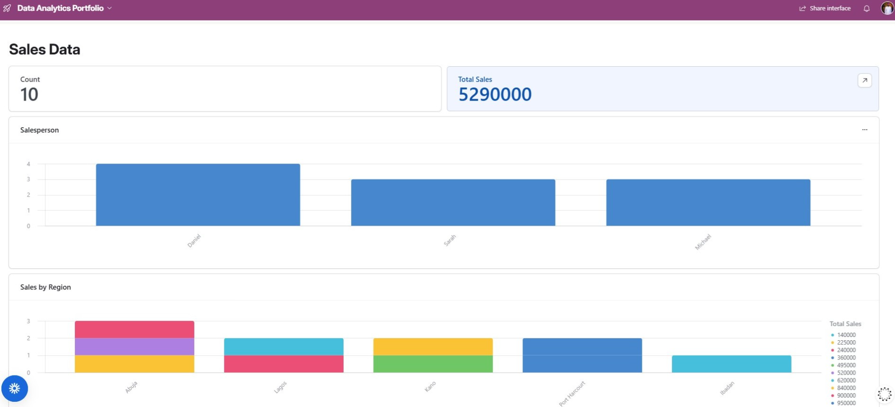
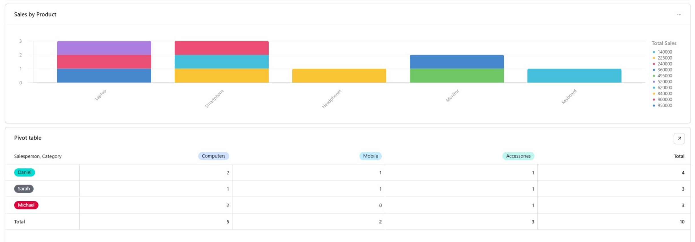

# Sales Performance Analysis Dashboard

A data analytics project focused on analyzing sales performance across products, regions, and salespeople. The project transforms sales transaction data into calculated metrics, visual analysis, and an interactive Airtable dashboard.

## Tools Used

- Airtable
- Data Cleaning
- Data Analysis
- Data Visualization
- Dashboard Development

## Key Project Metrics

| Metric | Result |
|---|---:|
| Total Orders | 10 |
| Total Sales | ₦5,290,000 |
| Average Order Value | ₦529,000 |
| Highest Confirmed Salesperson | Daniel — ₦2,695,000 |
| Highest-Performing Region | Abuja — ₦1,600,000 |

---
## Project Overview

This project involved analyzing sales transaction data and developing an interactive Sales Performance Analysis Dashboard using Airtable.

The goal was to transform structured sales records into meaningful business insights by analyzing revenue, products, regions, and salesperson performance.

---

## Project Objectives

- Organize and structure sales transaction data.
- Clean and standardize the dataset.
- Calculate sales revenue for individual transactions.
- Measure overall sales performance.
- Compare product and regional performance.
- Analyze salesperson performance.
- Build an interactive dashboard for communicating results.
- Demonstrate how data can support business decision-making.

---

## Dataset

The dataset contains sales transaction records with the following fields:

- Order ID
- Order Date
- Customer
- Product
- Category
- Quantity
- Unit Price
- Total Sales
- Region
- Salesperson

---

## Data Cleaning & Preparation

The dataset was reviewed for consistency.

One identified issue was the use of both "Computer" and "Computers" as category values. These were standardized to "Computers" to ensure consistent analysis.

A calculated Total Sales field was created using:

**Total Sales = Quantity × Unit Price**

---

## Data Analysis

The analysis focused on:

- Total sales revenue
- Number of orders
- Average order value
- Sales by product
- Sales by region
- Salesperson performance
- Salesperson performance by category

---

## Dashboard

An interactive Airtable dashboard was developed to provide a clear visual overview of sales performance.

The dashboard includes:

- **Total Orders** — shows the number of sales transactions.
- **Total Sales** — shows total revenue generated.
- **Salesperson Performance** — compares sales activity across salespeople.
- **Sales by Region** — compares revenue across different regions.
- **Sales by Product** — compares performance across products.
- **Salesperson × Category Analysis** — shows how sales activity is distributed across salespeople and product categories.

### Dashboard Preview

#### Dashboard Overview

#### Dashboard Details

---

## Key Findings

| Metric | Result |
|---|---:|
| Total Orders | 10 |
| Total Sales | ₦5,290,000 |
| Average Order Value | ₦529,000 |
| Highest confirmed salesperson | Daniel — ₦2,695,000 |
| Highest-performing region | Abuja — ₦1,600,000 |

### Regional Performance

| Region | Sales |
|---|---:|
| Abuja | ₦1,600,000 |
| Lagos | ₦1,520,000 |
| Port Harcourt | ₦1,310,000 |
| Kano | ₦720,000 |
| Ibadan | ₦140,000 |

---

## Recommendations

1. Investigate the factors contributing to strong sales performance in Abuja and Lagos.
2. Review product-level sales performance to understand revenue contribution.
3. Examine successful salesperson approaches that could potentially be replicated across the team.
4. Investigate lower-performing regions and products for improvement opportunities.
5. Continue using the dashboard for regular sales performance reviews.

---

## Project Outcome

I successfully developed a structured sales analytics solution in Airtable, transforming transaction records into calculated metrics, analysis, visualizations, and an interactive dashboard.

The project demonstrates practical skills in:

- Data organization
- Data cleaning
- Data standardization
- Formula creation
- Data analysis
- Data visualization
- Dashboard development
- Business insight generation

---

## Tools Used

- Airtable
- Data Analysis
- Data Visualization
- Dashboard Development
